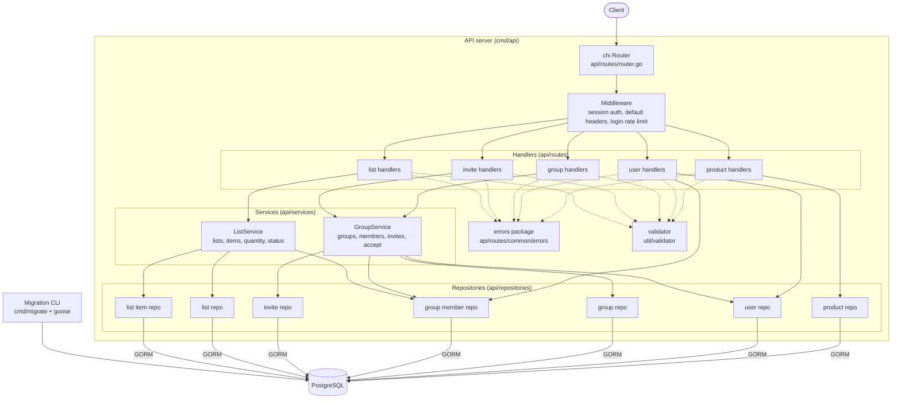

# Architecture

The API follows a layered design: HTTP handlers deal with requests and responses, services hold business logic and authorization that spans more than one entity, and repositories wrap all database access. Simple domains (products, users) skip the service layer and call their repositories directly from the handler; the richer domains (groups/invites and lists/items) have a service.

## Layers

- **Router** (`api/routes/router.go`): mounts everything under `/v1`, splits routes into a public group (register, login) and an authenticated group behind the session middleware. `GET /livez` is the health check.
- **Middleware** (`api/middleware`): `RequireAuth` reads the `auth-session` cookie (gorilla/sessions), puts the user id into the request context, and refreshes the session expiration on each request. A `LoginRateLimiter` fronts `POST /v1/users/login`.
- **Handlers** (`api/routes/<domain>`): decode and validate input, call a repository or service, and write responses. All error responses go through the shared errors package, which produces a single JSON shape with machine-readable codes.
- **Services** (`api/services/<domain>`): business logic and authorization. `GroupService` (`api/services/group`) covers groups, members, and invites; `ListService` (`api/services/list`) covers lists and items. Each domain has exactly one service struct constructed with `New(db)`, with one operation per file and shared helpers (such as the `ensureGroupMember` membership check) on the struct. Services return sentinel errors that handlers map to HTTP statuses with `errors.Is`, and use `services/util.WithTransaction` for multi-step writes.
- **Repositories** (`api/repositories/<domain>`): all GORM queries. Models live separately in `api/model/<domain>`.
- **Migrations** (`migrations/`, `cmd/migrate`): goose SQL migrations run by a small CLI, executed automatically in the Docker Compose setup. A separate `cmd/seed` drives the real HTTP endpoints to populate a known local account and data.

## Authorization

Authentication (who you are) lives in middleware; authorization (whether you may act on this resource) lives in the service, because it needs both the user and the resource. The convention across group/list endpoints is non-leaking: a caller who is not a member of the relevant group gets the same 404 a missing resource would return, so the endpoint never reveals that the resource exists. A 403 is reserved for a member who lacks a required role (for example, only a group owner may invite).

## Cross-cutting pieces

- **Errors** (`api/routes/common/errors`): `{"errors": [{code, detail, meta}]}` for every error response, built with `errorsCommon.NewError(code, detail)`. `WriteDBError`/`ClassifyDBError` map Postgres constraint violations (duplicate key becomes 409, foreign key violation becomes 422).
- **Validation** (`util/validator`): go-playground/validator with a custom `alphaspace` rule; failures are converted into error items with per-rule codes and the offending field in `meta`.
- **Config** (`config/`): strict env-based configuration via envdecode. Every variable is required.
