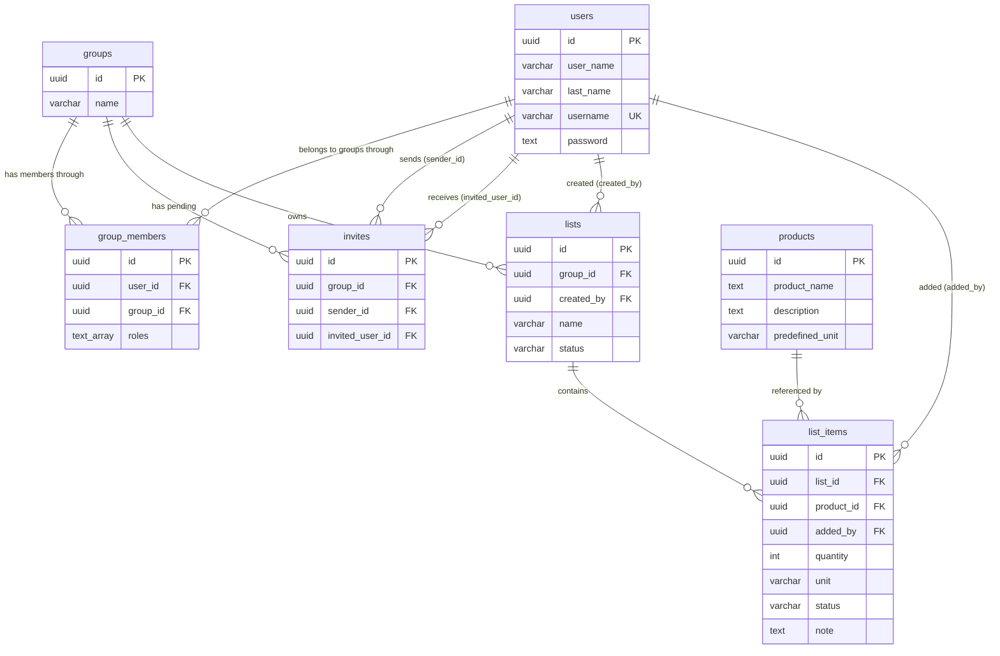

# Current state

A snapshot of what the API does today (October 2026). The API MVP is
feature-complete. The frontend lives in its own repository,
[Klynger/shopping-list-app](https://github.com/Klynger/shopping-list-app),
rather than in a monorepo with this API.

## Implemented features

- **Users and auth**: registration, login, and logout with cookie-based sessions (gorilla/sessions). Login is constant-time against username enumeration (a decoy bcrypt comparison runs when the username does not exist) and rate-limited. Sessions expire after a configurable max age and are refreshed on each authenticated request.
- **Users**: registration returns the created user (`id`, `name`, `lastName`, `username`; never the password). `GET /users/me` returns the caller's own full record, so a client can learn its own id without depending on group membership. `GET /users/{id}` returns a shape that depends on the relationship: yourself or a group co-member get the full record, anyone else gets a trimmed public profile (`id`, `name`, `username`), so the directory cannot be harvested.
- **Products**: full CRUD (list, get, create, update, delete), all routed. Create returns the created product, including its id. Products are a shared global catalog with no per-user ownership, so any authenticated user may read or mutate them.
- **Groups**: an authenticated user can create a group (becoming its owner), list the groups they belong to, and list a group's members (member-only).
- **Invites**: a group owner can invite another user by username; creating an invite is idempotent (a repeat invite returns the existing one rather than conflicting). The invited user can accept, which creates the membership and deletes the invite in one transaction. Both a user's own pending invites and a group's pending invites (member-only) can be listed; each listed invite names its group, its sender, and the invited user.
- **Lists**: a group member can create a shopping list in a group, read that group's lists, and change a list's status. A list belongs to exactly one group.
- **Items**: a member can add a product from the shared catalog to a list, read a list's items (with product names), change an item's quantity (increment / decrement, with a floor of 1), update its mutable fields (quantity, unit, note), change its status, and remove it. One row per product per list; adding a product already on the list is rejected with a 409 conflict.

## Endpoints

| Method | Path | Auth | Handler |
|--------|------|------|---------|
| GET | `/livez` | No | Health check |
| POST | `/v1/users` | No | Register |
| POST | `/v1/users/login` | No | Login (rate-limited) |
| POST | `/v1/users/logout` | Yes | Logout |
| GET | `/v1/users/me` | Yes | Get the caller's own user |
| GET | `/v1/users/{id}` | Yes | Get user (full for self / co-member, public profile otherwise) |
| GET | `/v1/products` | Yes | List products |
| GET | `/v1/products/{id}` | Yes | Get product |
| POST | `/v1/products` | Yes | Create product |
| PUT | `/v1/products/{id}` | Yes | Update product |
| DELETE | `/v1/products/{id}` | Yes | Delete product |
| POST | `/v1/groups` | Yes | Create group |
| GET | `/v1/groups` | Yes | List the caller's groups, as their membership rows (see Response shapes) |
| GET | `/v1/groups/{groupId}/members` | Yes | List a group's members (member-only) |
| POST | `/v1/groups/{groupId}/invites` | Yes | Create invite (idempotent; owner-only) |
| GET | `/v1/groups/{groupId}/invites` | Yes | List a group's pending invites (member-only) |
| POST | `/v1/groups/{groupId}/invites/accept` | Yes | Accept invite |
| GET | `/v1/invites` | Yes | List the caller's pending invites |
| POST | `/v1/groups/{groupId}/lists` | Yes | Create list |
| GET | `/v1/groups/{groupId}/lists` | Yes | List a group's lists |
| PATCH | `/v1/lists/{listId}/status` | Yes | Change a list's status |
| POST | `/v1/lists/{listId}/items` | Yes | Add item to list |
| GET | `/v1/lists/{listId}/items` | Yes | List a list's items |
| PATCH | `/v1/lists/{listId}/items/{itemId}` | Yes | Update an item (quantity, unit, note) |
| DELETE | `/v1/lists/{listId}/items/{itemId}` | Yes | Remove an item |
| POST | `/v1/lists/{listId}/items/{itemId}/increment` | Yes | Increase item quantity |
| POST | `/v1/lists/{listId}/items/{itemId}/decrement` | Yes | Decrease item quantity (floor 1) |
| PATCH | `/v1/lists/{listId}/items/{itemId}/status` | Yes | Change an item's status |

## Response shapes

Most responses are a resource's DTO (or an array of them) with camelCase keys. A few shapes are not obvious from the path:

- **`GET /v1/groups`** returns the caller's **membership rows**, not plain groups: one object per group the caller belongs to, joined with the group and the caller's own user record.

  ```json
  [
    {
      "id": "<group_members row id>",
      "userId": "<the caller's user id>",
      "userName": "Ana",
      "userLastName": "Silva",
      "groupId": "<group id>",
      "groupName": "Home",
      "roles": ["owner"]
    }
  ]
  ```

  `id` is the membership id, not the group id; use `groupId` to address the group. `userId`, `userName`, and `userLastName` are always the caller (the same in every row), and `roles` are the caller's roles in that group (`owner`, `member`), which is how a client tells whether it may invite. `GET /v1/groups/{groupId}/members` returns the same row shape, one per member of the group.
- **`GET /v1/invites`** and **`GET /v1/groups/{groupId}/invites`** return pending invites as `{id, groupId, groupName, senderId, senderUsername, invitedUserId, invitedUsername}`. For the caller's own listing the invited user is always the caller; for a group's listing it says who each invite is waiting on.
- **Create endpoints** all return the new resource's id. `POST /v1/users` and `POST /v1/products` return the full created DTO (with `id`); the service-backed creates return a small output object keyed by resource: `{groupId, userId}` for a group, `{listId}` for a list, `{itemId}` for an item, and `{inviteId}` for an invite.

## Error handling

All errors use one JSON shape:

```json
{
  "errors": [
    {
      "code": "INVALID_UUID",
      "detail": "the provided id is not a valid UUID",
      "meta": { "field": "id" }
    }
  ]
}
```

Codes are defined in `api/routes/common/errors`. Statuses follow the failure type: 400 for malformed input, 401 for auth failures (including unknown username on login, to avoid leaking account existence), 403 for permission problems (a member who lacks a required role), 404 with entity-specific codes, 409 for duplicates (such as `USERNAME_TAKEN` or `ITEM_ALREADY_ON_LIST`), 422 for validation and foreign key violations, and 500 only for genuine server faults. The group and list service layers use sentinel errors that handlers map to statuses with `errors.Is`.

Access to another user's or group's data is non-leaking: where a caller is not allowed to see a resource, the response is the same 404 a missing resource would give (for lists, items, group members, a group's invites, and inviting into a group), so the endpoint never reveals that something exists to someone who cannot see it.

## Database

PostgreSQL with goose SQL migrations (`migrations/`). All tables use UUID primary keys and soft deletes via `deleted_at`, with one deliberate exception: `list_items` are hard-deleted (see Delete behavior).

### Entity relationships



- **users and groups** form a many-to-many relationship through `group_members`, which also carries the member's roles (`owner`, `member`) as a Postgres text array. A user can join a group only once (`UNIQUE (user_id, group_id)`).
- **invites** connect a group to two users: the sender (`sender_id`) and the invited user (`invited_user_id`). A user can have only one pending invite per group (`UNIQUE (group_id, invited_user_id)`). Accepting an invite creates the `group_members` row and deletes the invite in one transaction.
- **products** stand alone: no foreign key to users or groups, so every product is a shared, global catalog entry. Lists and items connect products to groups without changing that.
- **lists and list_items** hold the group-specific data. A list belongs to exactly one group; an item belongs to one list and references one catalog product.

## Shopping lists and items (design of record)

Groups own shopping lists made of items, where each item points at a product from the shared catalog. All of create / read / update / delete / status is implemented for both lists and items (see the Endpoints table).

Two tables follow the existing conventions (UUID primary keys, timestamps) with one deliberate exception: `list_items` are hard-deleted rather than soft-deleted (see Delete behavior).

- **lists**: a shopping list that belongs to exactly one group. A group can have many lists, and a list cannot exist outside a group: `group_id` (FK to groups) is mandatory (`NOT NULL`). Other fields: `name`, `created_by` (FK to users), and `status`.
- **list_items**: a single line on a list. Fields: `list_id` (FK to lists), `product_id` (FK to products), `quantity` (default 1), `unit` (optional; overrides the product's `predefined_unit` for this line), `status`, `added_by` (FK to users), and an optional `note`.

### Design decisions

- **Products stay a shared catalog.** They are not scoped to a group; any group's items can reference any product. Products carry an optional `predefined_unit` (their canonical unit, such as "L" for milk).
- **Units: canonical plus override.** A product carries an optional `predefined_unit`, and a `list_item` carries an optional `unit` that overrides it for that one line. The effective unit is the item's `unit` when set, otherwise the product's `predefined_unit`, otherwise none.
- **One row per product per list.** A `UNIQUE (list_id, product_id)` prevents a product appearing twice on a list; a duplicate add is a 409 conflict rather than a merge (changing quantity is a separate operation). Because `list_items` are hard-deleted, removing then re-adding a product is just a fresh insert. Under a concurrent double-add, the constraint (not the transaction) forces one insert to fail.
- **Delete behavior.** Deleting a group cascades to its lists, and deleting a list cascades to its items (`ON DELETE CASCADE`). `list_items` themselves are **hard-deleted**, a deliberate divergence from the soft-delete convention: they are ephemeral "this product is currently on this list" records whose history has no value (migration `00003` drops their `deleted_at`). The `list_items.product_id` FK is `ON DELETE RESTRICT`, and products are only soft-deleted, so an item always keeps a valid product reference.
- **Statuses are extensible enums, transitions are free.** A `list` has `planning` / `active` / `completed`; a `list_item` has `pending` / `in_cart` / `purchased` / `cancelled` (the last for giving up on a product while leaving it on the list, distinct from deleting it). Each is a `TEXT` column with a `CHECK` constraint, so adding a value is a simple migration (migration `00004` added `cancelled`). Transitions are **not ordered**: any value in the allowed set is accepted from any current status (you can un-cart an item or reopen a list), validated only against the allowed set.
- **Access control (non-leaking).** Group membership is enforced in the service layer. Every list/item/group-scoped endpoint, read and write alike, reports a non-member exactly as it reports a missing resource: a 404. Creating a list in, adding an item to, or inviting into a group the caller is not a member of all return 404, never revealing the group exists. A 403 is used only when the caller *is* a member but lacks the required role (for example, only an owner may invite).

## Testing

sqlmock tests (18 test files) cover the repository layer (`list`, `list_item`, `group_member`, `product`) and the service layer (the `list` and `group` services: list/item CRUD and status, my-groups, group members, invite listing), plus a user model test. Handlers still have no unit tests; they are exercised by manual end-to-end runs against a real Postgres during development. `scripts/verify.sh` (run by CI) does gofmt, `go vet`, build, `go test`, a migration up/down cycle, and a smoke test.

## Known gaps and TODOs

- Logging is minimal (a few `fmt.Println` calls); there is no structured logging or request tracing (tracked as KLY-11).
- A committed `.env` holds throwaway local secrets; real secret management is deferred until a deployment exists (KLY-6).
- The invite endpoint still looks an invitee up by username before the membership gate, so a non-member can tell an existing username from a missing one (a minor oracle that registration already exposes). A dedicated "search users by username" endpoint would both serve the invite UI and close this.
- Handler-level tests are absent; coverage lives at the service and repository layers.

## Planned next

- Deploy to a local k3s cluster as an infrastructure-learning exercise (KLY-21).
