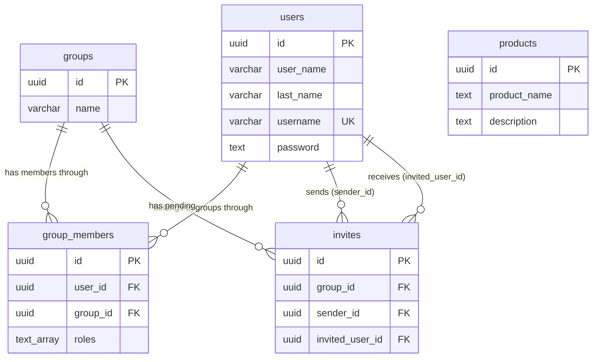
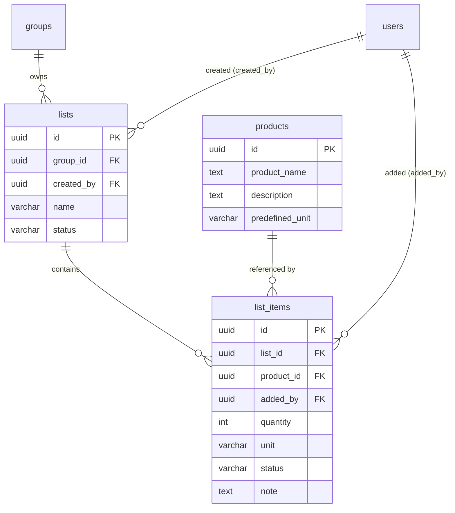

# Current state

A snapshot of what the API does today (October 2026).

## Implemented features

- **Users and auth**: registration, login, and logout with cookie-based sessions (gorilla/sessions). Passwords are validated against the stored credentials on login; sessions expire after a configurable max age and are refreshed on each authenticated request.
- **Products**: full CRUD (list, get, create, update, delete). List and get are wired into the router; update and delete handlers exist but are not routed yet.
- **Groups**: an authenticated user can create a group and becomes its owner.
- **Invites**: a group owner can invite another user to the group, and the invited user can accept, which creates the membership and deletes the invite inside a transaction.
- **Lists**: a group member can create a shopping list in a group and read that group's lists. A list belongs to exactly one group.
- **Items**: a member can add a product from the shared catalog to a list and read a list's items (returned with their product names). One row per product per list; adding a product that is already on the list is rejected with a 409 conflict.

## Endpoints

| Method | Path | Auth | Handler |
|--------|------|------|---------|
| GET | `/livez` | No | Health check |
| POST | `/v1/users` | No | Register |
| POST | `/v1/users/login` | No | Login |
| POST | `/v1/users/logout` | Yes | Logout |
| GET | `/v1/users/{id}` | Yes | Get user |
| GET | `/v1/products` | Yes | List products |
| GET | `/v1/products/{id}` | Yes | Get product |
| POST | `/v1/products` | Yes | Create product |
| POST | `/v1/groups` | Yes | Create group |
| POST | `/v1/groups/{groupId}/invites` | Yes | Create invite |
| POST | `/v1/groups/{groupId}/invites/accept` | Yes | Accept invite |
| POST | `/v1/groups/{groupId}/lists` | Yes | Create list |
| GET | `/v1/groups/{groupId}/lists` | Yes | List a group's lists |
| POST | `/v1/lists/{listId}/items` | Yes | Add item to list |
| GET | `/v1/lists/{listId}/items` | Yes | List a list's items |

## Error handling

All errors use one JSON shape:

```json
{
  "errors": [
    {
      "code": "INVALID_UUID",
      "detail": "the provided id is not a valid UUID",
      "meta": { "field": "id" }
    }
  ]
}
```

Codes are defined in `api/routes/common/errors`. Statuses follow the failure type: 400 for malformed input, 401 for auth failures (including unknown username on login, to avoid leaking account existence), 403 for permission problems, 404 with entity-specific codes, 409 for duplicates (such as `USERNAME_TAKEN` or `ALREADY_INVITED`), 422 for validation and foreign key violations, and 500 only for genuine server faults. The group service layer uses sentinel errors so handlers map failures with `errors.Is`.

## Database

PostgreSQL with goose SQL migrations (`migrations/`). All tables use UUID primary keys and soft deletes via `deleted_at`.

### Entity relationships



- **users and groups** form a many-to-many relationship through `group_members`, which also carries the member's roles (`owner`, `member`) as a Postgres text array. A user can join a group only once (`UNIQUE (user_id, group_id)`).
- **invites** connect a group to two users: the sender (`sender_id`) and the invited user (`invited_user_id`). A user can have only one pending invite per group (`UNIQUE (group_id, invited_user_id)`). Accepting an invite creates the `group_members` row and deletes the invite in one transaction.
- All foreign keys cascade on delete, though in practice rows are soft deleted rather than removed.
- **products** stand alone: they have no foreign key to users or groups, so every product is a shared, global catalog entry. The lists and items (below) connect products to groups without changing that: products stay a generic catalog (Milk, Eggs), and the group-specific data lives in the new tables.

## Shopping lists and items

The design of record for the lists and items feature: groups own shopping lists made of items, where each item points at a product from the shared catalog. The tables, repository, and service layers exist, and the first endpoints are live: create a list, read a group's lists, add an item, and read a list's items (see the Endpoints table). The remaining operations are tracked as tickets rather than described here: changing an item's quantity, item and list status transitions, and removing an item from a list.

Two new tables. They follow the existing conventions (UUID primary keys, timestamps) with one deliberate exception: `list_items` are hard-deleted rather than soft-deleted (see Delete behavior).

- **lists**: a shopping list that belongs to exactly one group. A group can have many lists (for example "Weekly groceries" and "Party supplies"), and a list cannot exist outside a group: `group_id` (FK to groups) is mandatory (`NOT NULL`), so there are no ownerless lists. Other fields: `name`, `created_by` (FK to users, who made it), and `status` (see below).
- **list_items**: a single line on a list. It belongs to exactly one list and references one product from the shared catalog. Fields: `list_id` (FK to lists), `product_id` (FK to products), `quantity` (default 1), `unit` (optional; overrides the product's `predefined_unit` for this line), `status` (see below), `added_by` (FK to users), and an optional `note`.



### Design decisions

- **Products stay a shared catalog.** They are not scoped to a group; any group's items can reference any product, which keeps the catalog generic and reusable. Products gain an optional `predefined_unit` (their canonical unit, such as "L" for milk). Giving products an owner, or per-user/per-group templates, is deferred; it can be added later without changing this model.
- **Units: canonical plus override.** A product carries an optional `predefined_unit`, and a `list_item` carries an optional `unit` that overrides it for that one line. The effective unit is the item's `unit` when set, otherwise the product's `predefined_unit`, otherwise none. Both are free text for now, with no fixed set or conversion.
- **One row per product per list.** A `UNIQUE (list_id, product_id)` prevents a product appearing twice on a list. Adding a product that is already on the list is rejected with a 409 conflict ("already on the list") rather than merged, changing how much you need is a separate operation (not part of add). Because `list_items` are hard-deleted (next bullet), removing then re-adding a product is just a fresh insert; there is no soft-deleted row to revive or collide with. Under a concurrent double-add, the constraint forces one insert to fail, which maps to the same conflict, so the constraint is the enforcement mechanism, not an error to work around.
- **Delete behavior.** Deleting a group cascades to its lists, and deleting a list cascades to its items (`ON DELETE CASCADE`). `list_items` themselves are **hard-deleted**, a deliberate divergence from the soft-delete convention: they are ephemeral "this product is currently on this list" records whose history has no value, so removing one deletes the row outright (migration `00003` drops their `deleted_at`). Products, by contrast, are only ever soft deleted; the `list_items.product_id` FK is `ON DELETE RESTRICT` to document that a product cannot be hard-removed while a list still references it, and since a soft-deleted product's row stays, items keep a valid reference (the app can flag such an item as unavailable).
- **Statuses are extensible enums.** A `list` moves `planning` → `active` → `completed` (build it, shop it in the store, then archive the trip). A `list_item` moves `pending` → `in_cart` → `purchased`. Both are stored as a `TEXT` column with a `CHECK` constraint listing the allowed values, so adding a value later is a simple migration rather than a painful native-enum alter. Adding values is expected; removing one is the breaking change to avoid.
- **Access control.** Group membership is required to create a list in a group, and only members of the owning group can read or modify that group's lists and items. This is enforced in the service layer the same way invites already check membership. The two behaviors differ by operation, deliberately: the **read** endpoints (a group's lists, a list's items) return **404** to non-members, collapsing "not a member" and "does not exist" so the endpoint never reveals that a group or list exists to someone who cannot see it. The **write** endpoints (create list, add item) currently return **403** for a non-member. That inconsistency is known; aligning the writes with the no-leak reads rides on the broader access-control work.

## Testing

Growing but uneven. The lists/items work is covered by sqlmock tests at both the repository layer (`list`, `list_item`, `group_member`) and the service layer (create list, add item, read lists, read items), alongside the original product repository test and a user model test. Handlers still have no tests, and the older resources (users, groups, invites) have little coverage.

## Known gaps and TODOs

- Product update and delete handlers are implemented but not registered in the router.
- Invite creation is not idempotent; inviting an already-invited user returns 409 instead of returning the existing invite.
- Login has a TODO to mitigate timing attacks on username lookup.
- Logging is minimal (a few `fmt.Println` calls); there is no structured logging or request tracing.
- A group's lists and a list's items are now readable, but there are still no endpoints to list the groups a user belongs to, a group's members, or pending invites.
- List and item mutation beyond adding an item is not implemented yet: changing an item's quantity, item/list status transitions, and removing an item.
